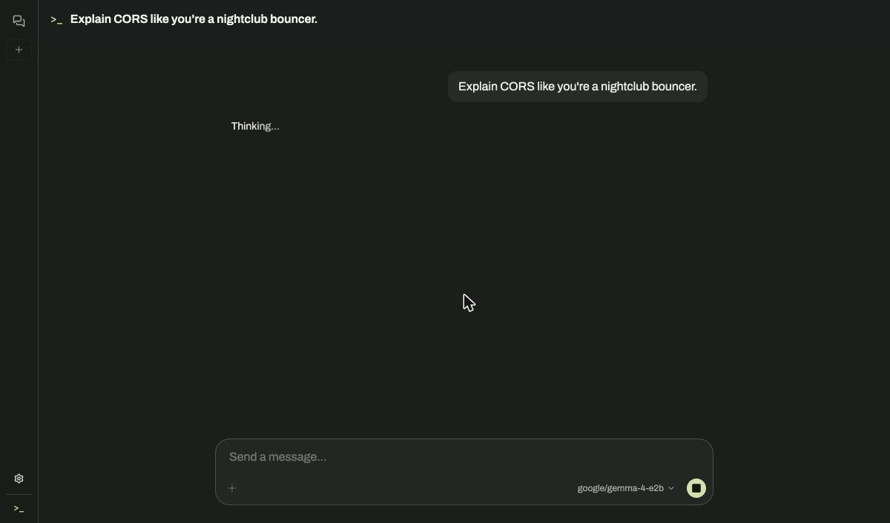
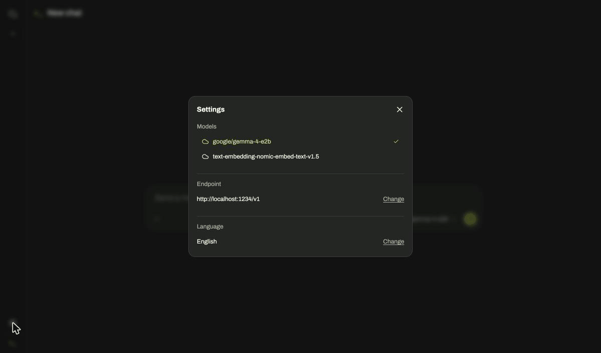

# Lime — local AI chat

A chat client for the language models you run yourself. Point it at any
OpenAI-compatible server (LM Studio, llama.cpp, vLLM) and chat in the browser, with
streaming replies you can stop. No backend of its own: conversations stay in your
browser (IndexedDB). English, Portuguese (pt-PT) and German.





## Try it

**Live:** [lime-zeta-three.vercel.app](https://lime-zeta-three.vercel.app/), with your
own endpoint (below). Lime has no models of its own, so without one the model list is
empty.

### Connect LM Studio

1. In [LM Studio](https://lmstudio.ai), download and load a chat model.
2. Open the **Developer** tab, start the server (default port `1234`) and turn on
   **Enable CORS** in its settings. Without CORS the browser blocks every request.
3. In Lime, open **Settings → Endpoint**, enter `http://localhost:1234/v1` and press
   **Load models**.
4. Pick the model in the composer and send a message.

Chrome or Edge recommended. The live site is HTTPS and LM Studio is plain HTTP on
`localhost`: Chrome may ask to allow access to devices on your local network (allow it).
If your browser refuses the connection, run Lime locally instead (below).

### Run locally

```bash
npm install
npm run dev   # http://localhost:5173, endpoint preset to http://localhost:1234/v1
```

Node 24 (`.nvmrc`). `VITE_API_BASE_URL` in `.env.local` sets a different default endpoint.

## What's in v1

- **Any OpenAI-compatible endpoint**, through the Responses API, with **streaming** replies.
- **Stop** a reply at any time; interrupted questions are kept and marked "Stopped".
- **Sessions saved locally:** create, rename and delete conversations; nothing leaves your
  browser except the request to your endpoint.
- **Readable errors:** unreachable endpoint, HTTP errors and storage failures are explained
  in the UI, translated, never shown as raw server output.
- **English, Portuguese (pt-PT) and German.**

Quality: unit-tested state and decision logic (Vitest); CI runs lint, format check, tests
and build on every PR; every PR gets a Vercel preview.

## Not in v1

- **In-browser models (WebGPU):** built and paused. The models small enough for a phone
  got basic facts wrong too often to be the first impression
  ([ADR-012](docs/adr/decisions.md)).
- TypeScript migration
- Regenerating or editing a message; showing model reasoning

## Docs

- [`docs/architecture.md`](docs/architecture.md): design, state, providers
- [`docs/storage.md`](docs/storage.md): browser storage
- [`docs/adr/decisions.md`](docs/adr/decisions.md): the decisions behind them
