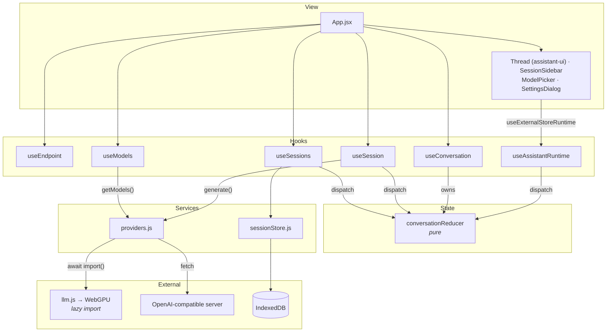
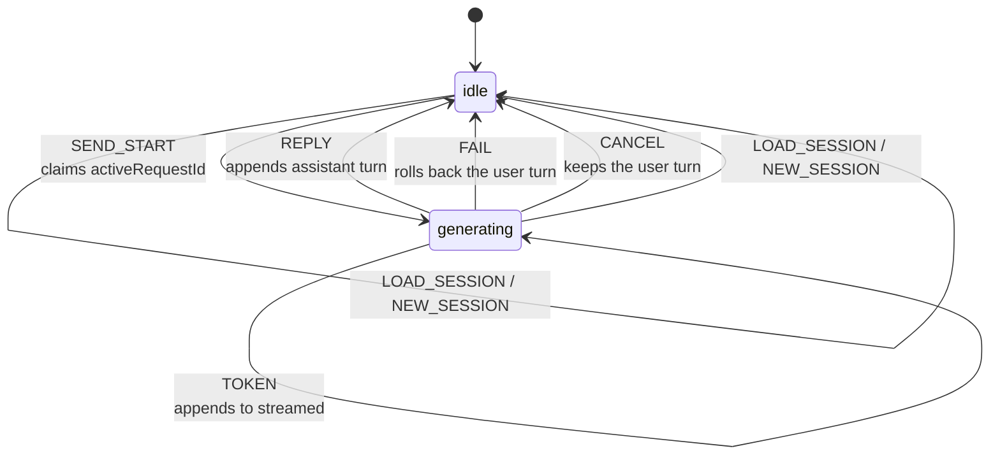
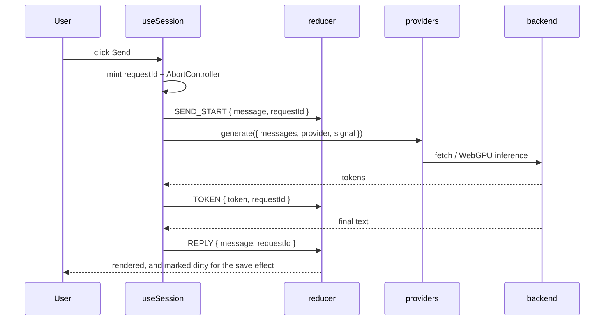
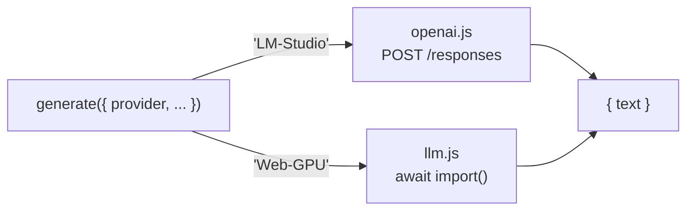

# Architecture

A local-first chat client for large language models. Two backends are supported and
presented identically to the user: a model running in the browser on WebGPU, and any
OpenAI-compatible HTTP server reachable from the browser (LM Studio, llama.cpp, vLLM).

Conversations are stored in IndexedDB. There is no backend of our own and no build-time
secret; everything the app needs is either in the browser or on the user's network.

---

## Directory layout

```
src/
  App.jsx            composition root — calls the hooks, lays out the components
  main.jsx           React entry point
  index.css          global styles, Tailwind theme tokens

  state/
    conversation.js    pure reducer + factory + title derivation
    useConversation.js owns the useReducer instance

  features/
    chat/        hooks/{useSession,useAssistantRuntime}.js, displayMessages.js, Title, ErrorBanner
    models/      hooks/{useModels,useRuntime}.js, selection.js, ModelPicker, ModelList, ModelInfo
    sessions/    hooks/useSessions.js, SessionSidebar
    settings/    hooks/{useEndpoint,usePanel,useStorage}.js, SettingsDialog, StorageMeter
    layout/      MobileHeader, MobileSheet, ScrollNudge
    onboarding/  useFirstRun, WelcomeModal

  services/
    providers.js     facade — chooses a backend, normalises the result
    openai.js        adapter for OpenAI-compatible HTTP servers
    llm.js           adapter for in-browser WebGPU inference
    localModels.js   in-browser model catalogue, free of any transformers import
    modelCache.js    storage estimates, model cache size, persistence
    sessionStore.js  IndexedDB access

  i18n/          en.js (source language) + pt.js, LocaleProvider, useT()
  lib/           framework-free helpers and generic hooks
  components/
    ui/            shadcn generated components
    assistant-ui/  assistant-ui generated components; thread.jsx is the chat UI
```

### The dependency rule

> A module in `features/*` may import from `state/`, `services/` and `lib/`.
> It should not import from another `features/*`.
> `state/` and `services/` never import from `features/`.

The second rule is currently broken in a few places (`chat` → `models`,
`layout` → `chat`, `sessions` → `settings`, `onboarding` → `models`). Don't treat
it as enforced, but avoid adding new cross-feature imports.

Imports that cross a top-level folder use the `@/` alias, defined in `vite.config.js`
and mirrored in `jsconfig.json` for editor resolution:

```js
import { generate } from '@/services/providers';
```

---

## Layers



Calls travel downward only. The reducer is the one piece of shared mutable state, and
because it is a pure function three hooks can act on it without any of them holding a
reference to another hook's setters.

---

## Conversation state

`state/conversation.js` is a plain reducer with no React dependency. It can be tested
directly in Node.

### Shape

| Field             | Meaning                                                       |
| ----------------- | ------------------------------------------------------------- |
| `sessionId`       | UUID of the row this conversation saves to                    |
| `messages`        | ordered turns, each `{ id, role, content: [{ type, text }] }` |
| `status`          | `'idle'` or `'generating'`                                    |
| `error`           | message from the last failed generation, or `null`            |
| `streamed`        | partial assistant text for the in-flight reply                |
| `dirty`           | whether `messages` holds changes the store has not seen       |
| `activeRequestId` | the one in-flight generation whose result will be accepted    |

### Transitions



Switching to another chat mid-reply behaves like Stop. `useSessions.openSession` dispatches
`CANCEL` to take ownership away, then loads the other session. The user turn was already
stored when it was sent, so it stays. A reload mid-reply keeps it too, since nothing runs
to roll it back.

Those kept turns are the only way a user message ends up unanswered, so the "Stopped"
marker is derived, not stored: `features/chat/displayMessages.js` adds a synthetic
`__stopped__:<id>` assistant message (status `incomplete`, reason `cancelled`) after every
user turn that nothing answers. Old sessions get the marker too, with no migration.

`LOAD_SESSION` and `NEW_SESSION` rebuild state from `createConversation()`, so they
reset `activeRequestId`, `status`, `error`, `streamed` and `dirty` without listing them
individually.

### Two invariants worth knowing

**`activeRequestId` decides whose reply counts.** `TOKEN`, `REPLY` and `FAIL` carry the
request id they belong to and are ignored unless it still matches. A reply that arrives
after the user switched sessions is dropped rather than appended to whatever happens to
be open. Without this, switching mid-generation appended one conversation's answer to
another and persisted it, producing two consecutive assistant turns and breaking the
role alternation that every subsequent request depends on.

**`dirty` decides what gets written.** A conversation that was just loaded is already on
disk, so persisting it again would only bump `updatedAt` and jump the row to the top of
the sidebar for a chat the user did no more than open. A conversation emptied by a failed
first turn _must_ be written, or the store keeps a turn the UI already rolled back.

---

## Sending a message



`useSession` builds the outgoing `messages` array from the current render's state rather
than reading it back after dispatch, because the dispatch is not visible until the next
render.

### Cancellation

A generation is cancelled when `activeRequestId` becomes `null` — which happens on
`LOAD_SESSION`, `NEW_SESSION`, `CANCEL`, or the request settling. `useSession` watches
that field and aborts its controller:

```js
useEffect(() => {
  if (conversation.activeRequestId === null) controllerRef.current?.abort();
}, [conversation.activeRequestId]);
```

Each backend honours the signal differently:

- **HTTP** — the signal is passed to `fetch`, which rejects with `AbortError` and closes
  the socket.
- **WebGPU** — `llm.js` installs an `InterruptableStoppingCriteria` and calls
  `.interrupt()` on abort. An interrupted run _resolves with partial output rather than
  throwing_, so `llm.js` calls `signal.throwIfAborted()` afterwards; without that the
  caller would treat a cancelled generation as a successful short reply.

Either way the rejection reaches `useSession`, which dispatches `FAIL` with a request id
the reducer has already retired — so the error is dropped and nothing surfaces to the
user. Ownership and cancellation are separate mechanisms: the reducer decides what is
still wanted, the controller stops what is not.

---

## Providers

`services/providers.js` merges both backends into one flat list and dispatches on the
result. Callers never branch on backend.



`getModels(baseURL)` returns entries of the shape:

```js
{ id: string, provider: 'Web-GPU' | 'LM-Studio', requiresLoad: boolean }
```

- The **WebGPU** models are offered only when `'gpu' in navigator`, and `requiresLoad`
  is true — each must be downloaded (390 MB – 1.5 GB) and loaded before it can answer.
- **LM-Studio** models are offered only when an endpoint is configured and answers
  `/models` within a 3-second timeout. An unreachable server drops the provider and the
  app continues with whatever remains.

### Full history, every request

Both backends receive the entire message array. The HTTP adapter previously used the
Responses API's `previous_response_id` to let the server hold the history and sent only
the newest turn. That was removed: every discontinuity — a page reload, opening a saved
session, changing endpoint, switching provider — broke the chain, and the app silently
sent one orphaned turn while the UI displayed the whole conversation.

Resending history costs nothing against a local server, and it makes sessions portable.

### Lazy loading

`llm.js` is reached only through `await import('./llm')`. This matters because
`@huggingface/transformers` pulls in about 23.5 MB of WASM. The model catalogue lives
in `localModels.js`, and the `transformers-cache` name is hard-coded in `modelCache.js`,
precisely so that _listing_ models does not import the module that would download the
runtime.

| Chunk             | Size (gzip) | When             |
| ----------------- | ----------- | ---------------- |
| `index.js`        | ~67 kB      | initial load     |
| `llm.js`          | ~148 kB     | first WebGPU use |
| ONNX runtime WASM | ~5.8 MB     | first WebGPU use |

---

## Persistence

`services/sessionStore.js` wraps IndexedDB through `idb`. One store, `sessions`, keyed by
`id` (a `crypto.randomUUID()` string) with an index on `updatedAt` so the sidebar can list
most-recent-first.

```
{ id, name, messages, updatedAt }
```

The connection is opened lazily and cached, with three failure paths handled explicitly:

- **`blocking()`** closes this connection when another tab needs to upgrade or delete the
  database. Without it, the other tab waits forever and this one hangs with an empty
  sidebar and no error.
- **A 5-second open timeout** turns an indefinite hang into a reportable error.
- **A failed open clears the cached promise**, so one failure does not poison the module
  for the lifetime of the tab.

Writes happen in an effect, never during render — rendering writes would hit storage on
every re-render, including once per streamed token.

### Storage accounting

Conversations are kilobytes; the cached model weights beside them in the Cache API are
hundreds of megabytes to gigabytes. `services/modelCache.js` reports both through
`navigator.storage.estimate()` — the one storage API present in every target browser —
and the settings panel renders the result.

Two things are worth knowing before touching that code. `estimate()` returns a `quota`
that is the origin's **total** budget rather than what is left, so free space is derived
as `quota - usage`. And every browser deliberately fuzzes the numbers: Chromium's quota
tracks free disk and moves as it fills, Firefox rounds usage into blocks, Safari raises
the quota on demand. They are good enough to warn with and not good enough to gate on,
which is why a download that looks too large is flagged but never blocked — the real
`QuotaExceededError` is caught in `features/models/hooks/useModels.js` instead.

The meter measures disk, not memory. Nothing in the codebase reports resident GPU memory,
and `llm.js` keeps every model loaded this session without disposing any of them.

Full detail, including the Chromium-only `usageDetails` fallback and the persistence
request: [`storage.md`](./storage.md).

---

## Configuration

| Variable            | Read by     | Purpose                                  |
| ------------------- | ----------- | ---------------------------------------- |
| `VITE_API_BASE_URL` | the browser | default endpoint, overridable at runtime |

See `.env.example`. Machine-specific values belong in `.env.local`, which is gitignored.

The endpoint the browser actually calls is resolved as:

```
localStorage → VITE_API_BASE_URL → 'http://localhost:1234/v1' in development → '' (provider disabled)
```

There is no dev proxy: the browser calls the server cross-origin in every mode, so the
server must send CORS headers (LM Studio: Server settings → Enable CORS).

---

## Deployment constraints

These are properties of the browser, not defects to be fixed in this codebase.

**A page served over HTTPS cannot reach a LAN server over HTTP.** The browser blocks the
request before it leaves. This is not CORS and no server header changes it — a publicly
hosted build can never talk to a private LM Studio instance.

**CORS always applies.** The app's origin (`localhost:5173` in dev) differs from the
server's, so the server must be configured to allow it — in dev, preview and production
alike.

**`crypto.randomUUID()` requires a secure context.** Every session and message id comes
from it. `localhost` qualifies; `http://192.168.x.x` does not. Serving the app over plain
HTTP on a LAN address would therefore throw on first render, and needs either HTTPS or a
non-secure-context fallback. _This has not been verified empirically — it follows from the
`[SecureContext]` attribute in the Web Crypto specification._

The practical consequence: the realistic deployment is the user running the app themselves,
not a publicly hosted page reaching into their network.
